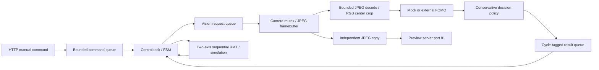

# Actual architecture

Production target: native ESP-IDF 6.0.2, ESP32, AI-Thinker camera wiring, FreeRTOS. Arduino and the Node upload relay are historical references.

The control task owns all FSM and motor state. Vision owns reusable RGB/model buffers and calls inference once per accepted trigger. Commands and results are value messages, not shared framebuffer pointers. Only one vision request is outstanding. Framebuffers are acquired/returned under the camera mutex; an initially queued frame is discarded to avoid using a pre-trigger image. Preview copies JPEG into PSRAM and releases the frame before any network send. Both snapshot and MJPEG acquisition run on port 81, so a stalled camera cannot occupy the command server. Stop the preview before requesting a snapshot; that image server handles one response at a time.

| Worker/resource | Budget / ownership |
|---|---|
| Control | priority 5, 6144-byte stack, 20 ms scheduling interval |
| Vision | priority 3, 12288-byte stack; no forced core affinity |
| HTTP control / preview | priority 2, 8192 / 4096-byte stacks, separate ports 80/81 |
| Commands | 4 messages, immediate busy response when full |
| Vision requests / results | 1 / 4 messages; at most captured+terminal per request |
| Motor | no pulse task; two RMT channels, one active at a time |
| Camera | QVGA JPEG, one framebuffer in PSRAM, OV2640/OV3660 supported by driver |
| Image buffers | 230400-byte decoded frame + `width*height*3` model input; allocated once |
| RMT hardware buffer | 2049 symbols, 8196 internal bytes, reused only after transmission completes |
| Preview copy | at most 128 KiB, freed after send; image server handles one response at a time |

## State transitions

`UNHOMED --arm, manual zero confirmation--> IDLE --trigger--> CAPTURE --> INFERENCE --> ACTUATE --> VERIFY_OPEN_LOOP --> RESET --> IDLE`

- DETECT is the accepted manual/software trigger because no validated presence sensor exists. CLASSIFY is a pure function between inference and actuation.
- CAPTURE includes frame acquisition, JPEG decoding and resizing. INFERENCE has a separate deadline.
- No detection, low confidence, unknown labels, more than one object (even the same category), or conflicting categories reject the item without movement and return to IDLE. No tie is guessed.
- A valid single object maps to configured axis coordinates. RMT completes axis 1, then axis 2. The period ramp is symmetric and linear in pulse period, not a calibrated constant-acceleration trajectory.
- VERIFY is only a configured settling interval. RESET returns both pulse estimates to the manually established zero. Neither verifies physical position or successful waste release.
- Any capture/inference/actuation failure or deadline latches FAULT and disables torque. Stop bypasses the command queue using a task notification. Pending commands are discarded.
- Faults invalidate the cycle ID and reference. Late vision results cannot move a motor. Recovery waits for the outstanding vision operation to return; a permanently stuck third-party model requires a device reset. No unsafe task deletion or automatic retry.
- Clear fault returns to UNHOMED. A new arm and manual reference are required. Drivers remain energized after normal completion to retain the open-loop reference; disarm via Stop.

`controller_submit()` is the task-context input boundary for future presence sensors. A future GPIO ISR should notify a debounced input task which submits CMD_TRIGGER, never call it directly from an ISR. Actual independent home/limit feedback requires new hardware and controller logic; it is not simulated as a successful measurement.

## Configuration and diagnostics

`main/Kconfig.projbuild` provides GPIO roles, thresholds, exact labels, axis targets/bounds, direction inversion, pulse periods/ramp and deadlines. `sdkconfig.defaults` enables PSRAM and a 4 MB flash profile with a 1500 KiB app partition. Confirm flash/PSRAM on the board before flashing. The user's original root sdkconfig is preserved locally; the helper uses `build/sdkconfig.sorter`.

HTTP status is JSON: state, faults, modes, reference, decision reason, pulse estimates, worker status, measured capture/inference times, heap/largest block/PSRAM and task stack high-water marks. These runtime values are instrumentation, not measurements obtained in this session. UART logs transitions and results, never pulses. JSON is used for telemetry; build configuration uses Kconfig, not a runtime JSON file.

The WPA2 AP has a fresh random password printed over UART each boot. It is not stored in source or NVS. HTTP writes require the per-boot page token in `X-Sorter-Token`; no CORS or GET mutations. This is a local bench interface, not an internet service or authenticated multi-user controller. HTTP acceptance means queued, not executed: check `command_count`, `command_result`, and state.
